<div align="center">

<picture>
  <source media="(prefers-color-scheme: dark)" srcset="public/brand/rawaj-logo-on-dark.svg">
  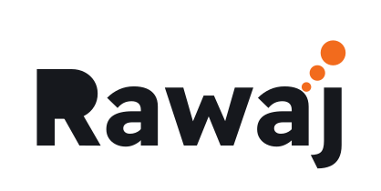
</picture>

### نبني مشروعك الرقمي، ثم نصنع له الطلب

**We build the product, then we create demand for it.**<br>
Marketing site for Rawaj (رواج), a software and digital-advertising studio based in Jordan, serving clients worldwide.


</div>

---

<table>
  <tr>
    <td width="50%">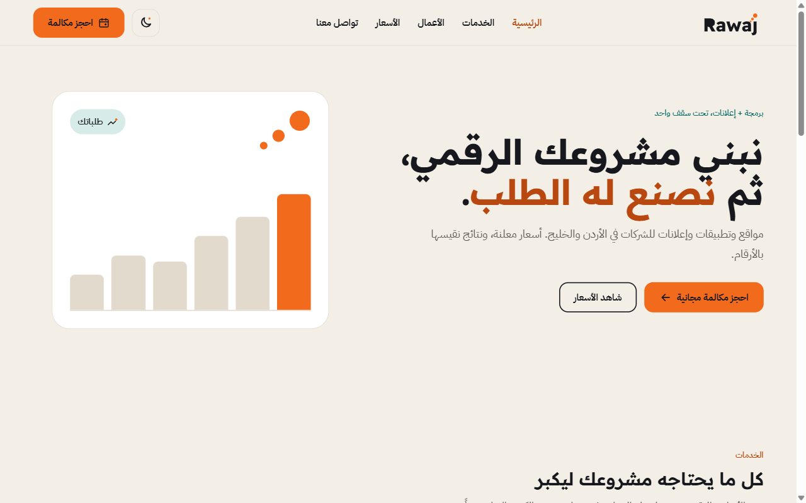</td>
    <td width="50%">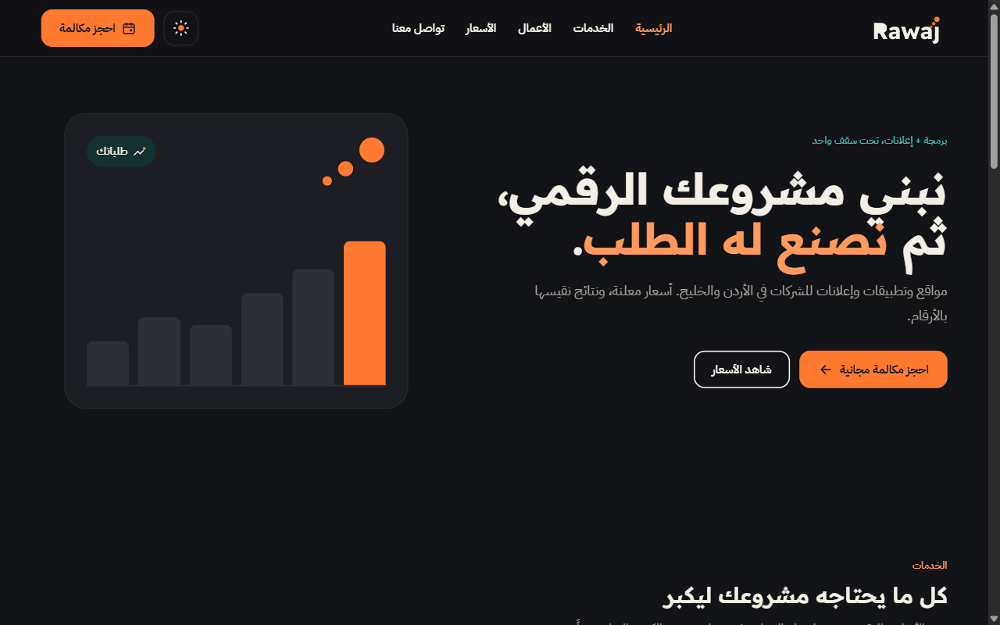</td>
  </tr>
  <tr>
    <td align="center"><sub>Home, light</sub></td>
    <td align="center"><sub>Home, dark</sub></td>
  </tr>
  <tr>
    <td>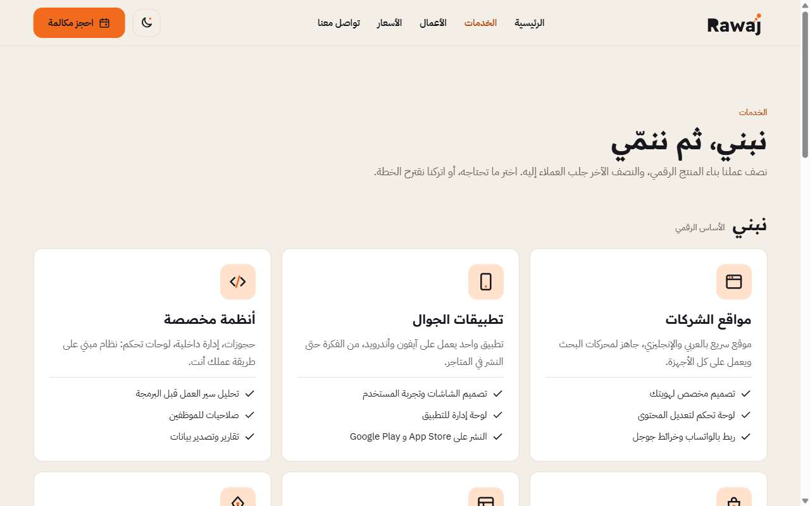</td>
    <td>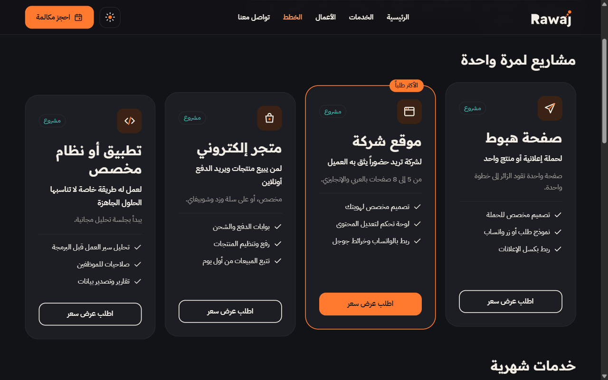</td>
  </tr>
  <tr>
    <td align="center"><sub>Services</sub></td>
    <td align="center"><sub>Plans, dark</sub></td>
  </tr>
</table>

<p align="center">
  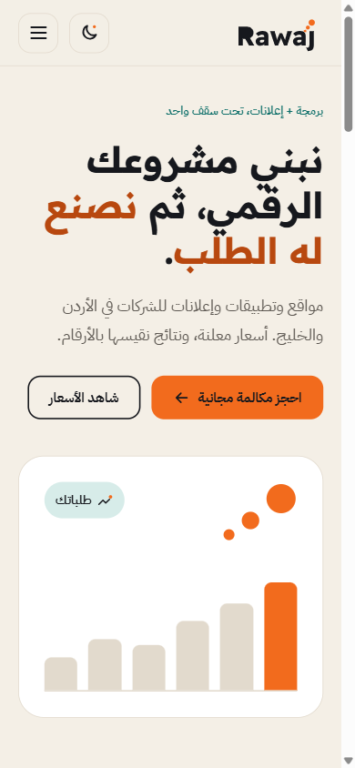
  &nbsp;&nbsp;
  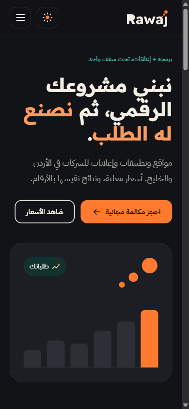
  <br><sub>390px: contact page with the live WhatsApp preview, and home in dark</sub>
</p>

## The site has one job

Turn a visitor into a WhatsApp message or a booked call. Every page ends at the same place.

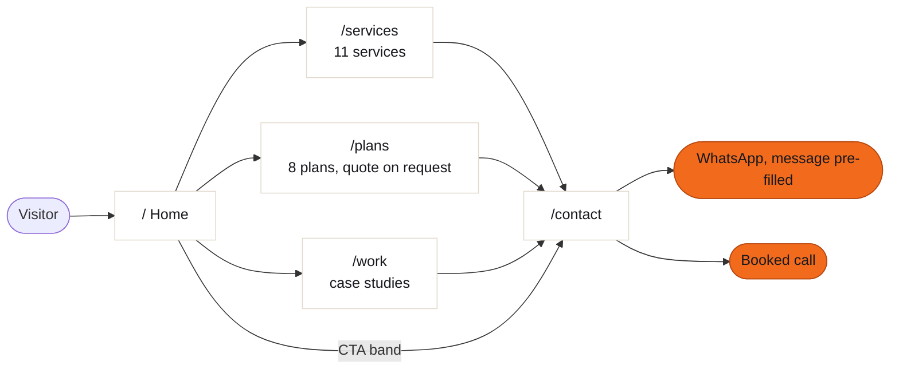

## Run it

Requires Node 22.

```bash
npm install
npm run dev        # http://localhost:3000
npm run generate   # static site in .output/public, upload to any static host
npm run tokens     # rebuild app/assets/css/tokens.css from design-system/tokens.json
```

## How it is built

No backend, no UI framework, plain CSS. Two sources of truth feed everything: the design tokens and one data file.

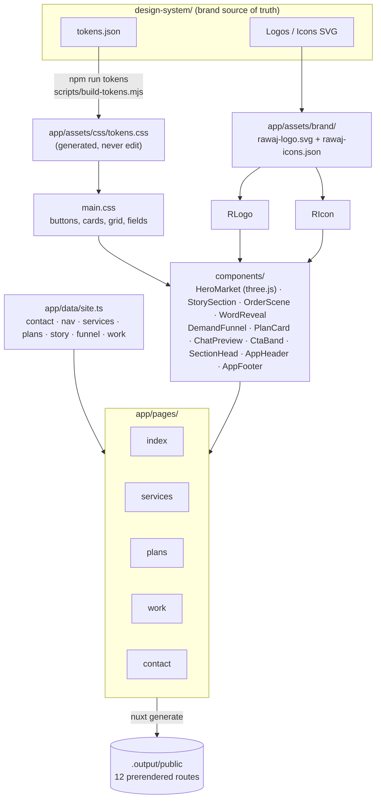

**Change content in `app/data/site.ts`, not in components.** Keeping all copy in one file is also what makes the planned English version a small job.

### Theme without a flash

The theme is decided by an inline script in `<head>` before the first paint, so a dark-mode visitor never sees a white flash.

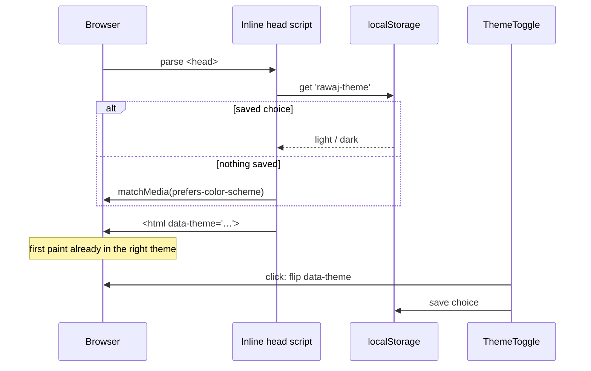

Inline logo and icons pick up the theme through CSS classes (`.rj-t .rj-m` for the logo, `.rj-i .rj-a .rj-f` for icons). Components need no theme code of their own.

## Brand

<p align="center">
  
  &nbsp;&nbsp;&nbsp;
  
  &nbsp;&nbsp;&nbsp;
  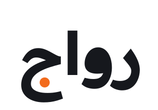
</p>

The three orange dots on the **j** rise to the upper right: a small chart going up. They are always three, always orange, always rising right (forced `direction: ltr` inside RTL pages). The Arabic wordmark keeps the ج dot in its correct place; moving it turns the word into رواخ.

### Colour tokens

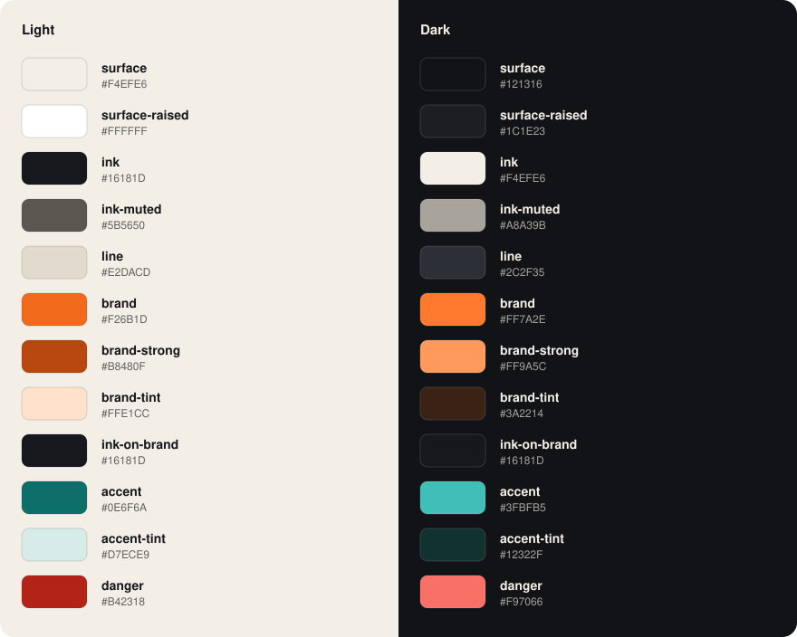

Proportion is about 70% surface and ink, 20% orange, 10% teal. Orange stands for action and ads, ink for trust, teal for the software side. Most competitors in the region use blue or blue-purple gradients, so Rawaj's orange stands out against them.

### Contrast (WCAG AA needs 4.5:1)

| Text pair | Light | Dark | |
|---|---:|---:|---|
| `ink` on `surface` | 15.5 | 16.2 | ✅ |
| `ink-muted` on `surface` | 6.3 | 7.4 | ✅ |
| `brand-strong` on `surface` (links, orange text) | 4.6 | 8.9 | ✅ |
| `ink-on-brand` on `brand` (button text) | 5.8 | 6.8 | ✅ |
| `accent` on `surface` | 5.2 | 8.3 | ✅ |
| `brand` as small text on `surface` | 2.9 | — | ❌ never used |
| white on `brand` | — | — | ❌ never used |

### Type, spacing, radius

| | |
|---|---|
| Headings | **Readex Pro** 600/700: display 56, h1 40, h2 28, h3 20 |
| Text | **IBM Plex Sans Arabic** 400/600: body 16, small 14, label 13 |
| Spacing | 4 · 8 · 16 · 24 · 48 · 96 px |
| Radius | 8 inputs · 14 cards and buttons · 28 hero panels |
| Icons | 25 custom, 24px grid, 2px round stroke, one orange "Rawaj dot" each |

## Services and plans

The 11 services fall into two groups: **build** the product (6), then **grow** demand for it (5).

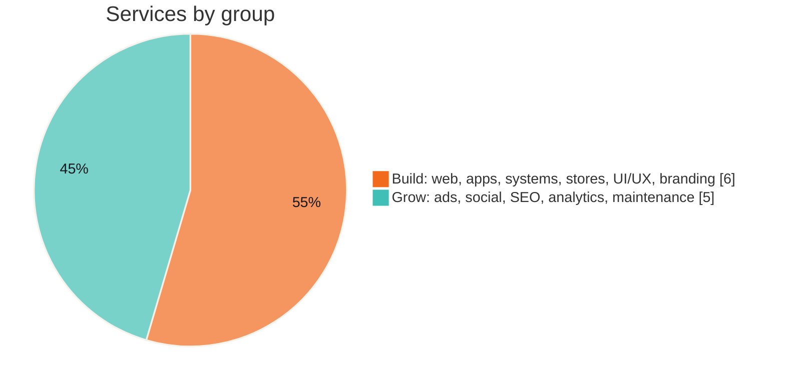

### Plans

The site shows **plans without prices**: what each one is for and what it includes, ending in a quote request. The visitor picks a plan, lands on `/contact?plan=<id>` with that plan pre-selected, and the WhatsApp message is written for them. Quotes come back in writing within a working day (in the client's currency).

| One-time projects | Monthly services |
|---|---|
| Landing page | Social media management |
| Company website (most requested) | Ads management |
| Online store | Google visibility (SEO) |
| Custom app or system | Maintenance and protection |
## Rules the code follows

1. **Tokens only.** Colours, spacing, radii and fonts come from `var(--…)`. Components contain no raw hex values.
2. **Contrast ≥ 4.5:1** in both themes. Text on orange uses `--ink-on-brand`, never white.
3. **Both themes, no extra code.** Every component works with `data-theme="light|dark"` as is.
4. **RTL first.** `lang="ar" dir="rtl"`. "Next" is `arrow-left`. Charts and the logo dots stay LTR so growth rises to the right.
5. **No invented facts.** No fake stats, clients or testimonials. Anything unknown stays visible as a `[placeholder]`.
6. **Accessible.** Real buttons, links and labels, a skip link, a 3px teal focus ring, touch targets of at least 44px, and `prefers-reduced-motion` respected.
7. **Responsive.** Works at 390px; the header collapses into a menu at 960px and below.

## Project layout

```
rawaj-web/
├── app/
│   ├── assets/
│   │   ├── brand/          rawaj-logo.svg, rawaj-icons.json (inlined, theme-aware)
│   │   └── css/            tokens.css (generated) + main.css
│   ├── components/         AppHeader, AppFooter, RLogo, RIcon, ThemeToggle, SectionHead, CtaBand,
│   │                       HeroMarket, StorySection, OrderScene, WordReveal, DemandFunnel, PlanCard, ChatPreview
│   ├── data/site.ts        all copy and data
│   ├── lib/market-scene.ts the hero's three.js scene (lazy-loaded)
│   ├── plugins/motion.ts   GSAP + ScrollTrigger, v-reveal directive
│   ├── pages/              index, services, plans, work, contact
│   └── app.vue
├── design-system/          brand guide, tokens.json, logos, icons, component previews
├── docs/                   README screenshots and palette
├── public/                 favicon, downloadable logos
├── scripts/build-tokens.mjs
├── nuxt.config.ts          head, fonts, pre-paint theme script
└── SPEC.md                 v1 scope and "done when"
```

## Before launch

Most placeholders live in `app/data/site.ts`.

- [ ] `contact.whatsapp` (format `9627XXXXXXXX`). The contact form stays disabled until it is set.
- [ ] `contact.phone`, `contact.email`, `contact.location`
- [ ] `work`: replace the 3 placeholder case studies with real projects and measured results
- [ ] Validate internal prices with the first real clients (they are not shown on the site)
- [ ] Domain and hosting (any static host serving `.output/public`)

## Roadmap

- [ ] English version with `@nuxtjs/i18n` (Arabic stays default, `/en` flips `dir`)
- [ ] Self-host the two fonts instead of Google Fonts
- [ ] GA4 and Meta Pixel once the domain is live
- [ ] Case-study pages at `/work/[slug]`

## Updating the design system

Replace `design-system/` with the newer copy and run `npm run tokens`. If the logo changed, copy `design-system/assets/Logos/rawaj-logo.svg` to `app/assets/brand/` and the logo files to `public/brand/`. Then retake the screenshots in `docs/`.
